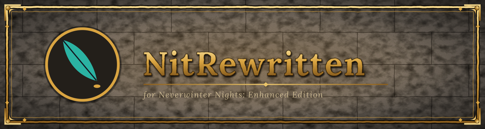

# NITREWRITTEN
### The definitive Mod Manager for Neverwinter Nights

NITREWRITTEN was created with a single purpose: to give Linux users a reliable, modern mod manager for Neverwinter Nights (Enhanced Edition and Diamond). It runs natively on Linux and is also available for Windows.

Built with a focus on simplicity and reliability, it keeps your game clean while offering advanced features for power users.

---

## 1. KEY FEATURES

1. **Streamlined Installation**: Drop any archive (.zip, .7z, .rar, .tar.gz) or individual game file (.hak, .tlk, .mod) and let the manager handle the directory structure automatically.
2. **Neverwinter Vault Integration**: Browse, search, and download thousands of projects directly within the app, complete with images and detailed descriptions.
3. **Advanced Conflict Engine**: Identify overlapping files between different mods to prevent game instability and ensure the correct content loads.
4. **Safe Clean Up**: Preview and move unmanaged files to a recovery folder. Saves and characters are protected by default.
5. **Dark Mode & Modern UI**: A clean, responsive interface with full support for Dark Mode.
6. **Robust Backup System**: One-click character and save-game backups.
7. **Multi-Platform Native Performance**: Native Linux support (AppImage) plus Windows executable.

---

## 2. QUICK START

### Linux Users (AppImage)
1. Download `NITREWRITTEN-x86_64.AppImage` from the [Releases](https://github.com/soulh34rt/NITREWRITTEN/releases) page.
2. Make it executable: `chmod +x NITREWRITTEN-x86_64.AppImage`.
3. Run it. No installation required.

### Windows Users
1. Download `NITREWRITTEN.exe` from the [Releases](https://github.com/soulh34rt/NITREWRITTEN/releases) page.
2. Run the executable. No installation required.

---

## 3. DEVELOPER SETUP (Source Code)

If you prefer to run from source or contribute:

1. Clone the repository.
2. Install dependencies:
   ```bash
   pip install -r requirements.txt
   ```
3. Launch the application:
   ```bash
   python nwnmods.py
   ```

---

## 4. CONTRIBUTING

Contributions are welcome! If you find a bug or have a feature request, please open an issue or submit a pull request.

---

*NITREWRITTEN is an independent project and is not affiliated with Beamdog, Bioware or Wizards of the Coast.*